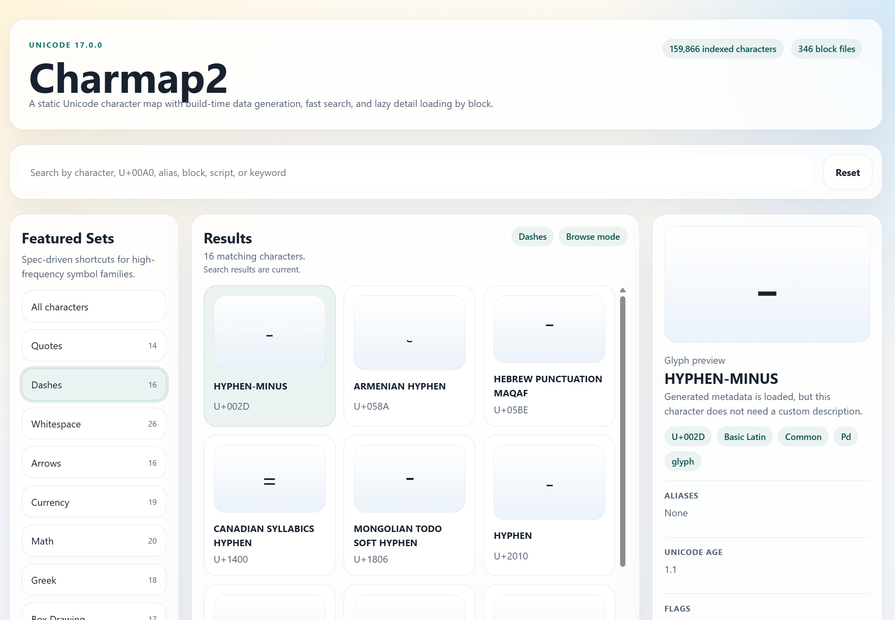

# Charmap2

Charmap2 is a static Unicode character map for the browser. It is built to replace the parts of Windows Character Map that people actually use, with faster search, clearer metadata, and better copy behavior.

## Live Site

- Site: <https://llaurila.github.io/charmap2/>



## What it does

- search by character, official name, alias, abbreviation, block, script, or code point
- preview the selected character with richer metadata
- explain confusing invisible, control, formatting, and combining characters
- inspect pasted text with an annotated preview, contextual findings, and occurrence navigation
- copy the raw character plus common escaped forms
- ship as a static site with no backend

## Status

Charmap2 is an early public project with a working character map, a single-string Text Inspector, Unicode ingestion scripts, generated data, and tests. Character details remain code-point-first, while Text Inspector provides contextual diagnostics for pasted text.

See the project specs for the current product and implementation direction:

- `SPECS.md`
- `specs/ROADMAP.md`
- `specs/TEXT_INSPECTOR.md`

## Stack

- Vite
- React
- TypeScript
- Vitest
- official Unicode Character Database files as the source of truth

## Local development

Requirements:

- Node.js 22.12.0 or newer
- pnpm 10.34.9 (pinned in `package.json`)

Enable pnpm through Corepack (install Corepack first if your Node.js distribution does not include it):

```bash
corepack enable
```

Install dependencies:

```bash
pnpm install
```

Start the dev server:

```bash
pnpm run dev
```

Open the local app and choose **Text Inspector** in the header. Paste text or try an example;
short input is analyzed live. Above 4,000 UTF-16 units, choose **Analyze** to run analysis in a
background worker. The current limit is 100,000 UTF-16 units, with paged previews and breakdown
rows so long text does not create an unbounded UI. Input is never cleaned or normalized.

Comparison and canonical normalization diagnostics are not part of this initial diagnostic release.

Run tests:

```bash
pnpm test
```

Build the app:

```bash
pnpm run build
```

## Usage analytics

The official production site uses [GoatCounter](https://www.goatcounter.com/) for
cookieless pageview, approximate visitor, and country statistics. Analytics loads
asynchronously only on `https://llaurila.github.io/charmap2/` in production builds.
Development servers, local previews, and deployments on other origins do not load
the analytics script.

The integration reports a fixed app path and title, excludes URL query parameters
and referrers, and does not track interactions or send search, inspector, or
clipboard contents. The footer includes a privacy explanation. In GoatCounter's
account settings, keep individual pageview collection disabled to use aggregate
statistics.

## Unicode data pipeline

- vendored Unicode source files live under `vendor/unicode/18.0.0/`
- the app generates static assets into `public/unicode/18.0.0/`
- the browser uses generated JSON, not raw Unicode text files

Useful commands:

```bash
pnpm run vendor:unicode
pnpm run generate:unicode
```

## Contributing

Issues and pull requests are welcome. Please read `CONTRIBUTING.md` before making larger changes.

For behavior changes that affect product scope, search rules, rendering rules, or data semantics, check `SPECS.md` first and call out any intentional spec changes in your PR.

## License

The Charmap2 source code is licensed under the MIT License. See `LICENSE`.

This project also vendors and derives data from the Unicode Character Database. See `THIRD_PARTY_NOTICES.md` for attribution and related terms.
